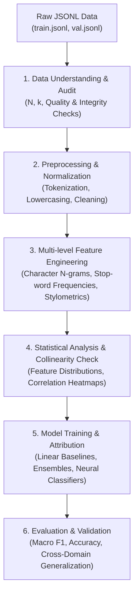

# PAN Authorship Attribution & Generative AI Detection

This repository contains the end-to-end framework for authorship attribution and generative AI text detection, based on the **PAN 2025 Shared Task 1** dataset.

---

## 1. System Pipeline Architecture



---

## 2. Literature Review Comparison Matrix

| Paper / Framework | Extracted Feature Space | Classifier / Model | Target Problem | Limitations / Gaps |
| :--- | :--- | :--- | :--- | :--- |
| **Stamatatos (2009, 2013)** | Character 3-to-5-grams, punctuation frequencies | SVM, Ensemble Classifiers | Traditional closed-set Authorship Attribution | High feature dimensionality; sensitive to domain shifts |
| **Koppel et al. (2011)** | Unmasking with iterative chunk degradation | Repeated Linear SVM | Authorship Verification (open-set 1 vs 1) | Requires long texts; computationally expensive |
| **Barlas & Stamatatos (2020)** | Fine-tuned contextual embeddings (BERT, RoBERTa) | Neural Cross-Entropy Classification | Cross-topic Authorship Attribution | Opaque decision boundaries; vulnerable to topic confounding |
| **Our Implementation** | Multi-level Stylometry (TTR, Punctuation Density, Length Variance) + Character/Word N-grams | Interpretable Scalable Baselines & Tree Ensembles | PAN 2025 Generative AI Detection & Model Attribution | Combines computational efficiency with high stylometric interpretability |

---

## 3. Dataset Dimensions & Inspection

| Split | Records ($N$) | Classes ($k_{labels}$) | Candidate Authors / Models ($k_{models}$) | Domains ($k_{genres}$) |
| :--- | :--- | :--- | :--- | :--- |
| **Train** | 23,707 | 2 (Human: 9,101; AI: 14,606) | 23 (Human + 22 AI models) | 3 (Fiction: 14,697; Essays: 4,661; News: 4,349) |
| **Validation** | 3,589 | 2 (Human: 1,379; AI: 2,210) | 23 (Human + 22 AI models) | 3 (Fiction: 2,226; Essays: 706; News: 657) |
| **Total** | **27,296** | **2** | **23** | **3** |

### Data Quality & Integrity
- **Corrupted Lines (JSON errors)**: 0
- **Missing Required Fields (`id`, `text`, `model`, `label`, `genre`)**: 0
- **Empty / Whitespace Texts**: 0
- **Duplicate Record IDs**: 0
- **Word Count Range**: 33 to 4,892 words (Mean: 621.2 words)
- **Data Integrity Status**: **EXCELLENT**

---

## 4. Key Exploratory Stylometric Findings

| Stylometric Metric | Human Written ($y=0$) | AI-Generated ($y=1$) | Stylistic Interpretation |
| :--- | :--- | :--- | :--- |
| **Mean Word Count** | **710.95** | **584.47** | Human texts are structurally longer and show higher variance |
| **Mean Character Count** | **3,941.83** | **3,580.48** | Corresponds to longer narrative passages in human fiction |
| **Type-Token Ratio (TTR)** | **0.4714** | **0.5224** | AI models exhibit higher vocabulary diversity per segment |
| **Punctuation Density** | **0.0375** | **0.0284** | Humans use **~32% more punctuation** (dialogue, dashes, parentheses) |
| **Average Word Length** | **4.342 chars** | **5.023 chars** | AI outputs feature slightly longer Latinate/formal lexical items |

---

## 5. Dual-Task Baseline Benchmark Results (Validation Set $N = 3,589$)

### Task 1: Binary Generative AI Detection (`0 = Human` vs `1 = AI`)
| Baseline Model | 5-Fold CV Macro F1 | Val Macro F1 | Val Accuracy | Val ROC-AUC | False Positives / Negatives |
| :--- | :---: | :---: | :---: | :---: | :---: |
| **Dummy (Majority Class)** | `38.12 ± 0.00%` | `39.18%` | `64.42%` | `50.00%` | 1,277 FP / 0 FN |
| **Complement Naive Bayes** | `91.55 ± 0.12%` | `90.15%` | `91.03%` | `96.50%` | 178 FP / 144 FN |
| **Logistic Regression (L1 Lasso)** | `98.20 ± 0.27%` | `97.84%` | `98.02%` | `99.68%` | 43 FP / 28 FN |
| **Logistic Regression (L2 Ridge)** | `98.45 ± 0.20%` | `97.99%` | `98.16%` | `99.71%` | 40 FP / 26 FN |
| **Linear SVM (Stamatatos Standard)** | **`98.88 ± 0.15%`** | **`98.60%`** | **`98.72%`** | **`99.84%`** | **26 FP / 20 FN** |

### Task 2: Author & Specific AI Model Attribution ($k = 23$ Classes: Human + 22 LLMs)
| Attribution Pipeline | 23-Class Macro F1 | 23-Class Top-1 Acc | 23-Class Top-3 Acc | 22-AI Exact Acc | 7-Family Attribution Acc |
| :--- | :---: | :---: | :---: | :---: | :---: |
| **Dummy (Majority Class - 23c)** | `2.28%` | `35.58%` | `39.26%` | `0.00%` | `35.58%` |
| **Complement Naive Bayes (23c)** | `22.03%` | `49.87%` | `69.46%` | `25.17%` | `61.58%` |
| **Logistic Regression (Multinomial L2 - 23c)** | `70.50%` | `81.64%` | `94.59%` | `72.75%` | `87.66%` |
| **Linear SVM (One-vs-Rest - 23c)** | **`73.27%`** | **`84.12%`** | **`94.93%`** | `75.69%` | **`89.05%`** |
| **Two-Stage Hierarchical (Stage1 Bin + Stage2 Linear SVM)** | `73.13%` | `83.87%` | `93.98%` | **`76.08%`** | `88.94%` |

---

## 6. Repository Structure

```
pan-authorship-attribution/
├── data/
│   └── processed/                      # Exported evaluation & ablation diagnostics (.csv)
├── notebooks/
│   └── 01_exploratory_analysis.ipynb   # Interactive Jupyter EDA & Presentation
├── reports/
│   └── figures/                        # Exported publication-ready figures (.png)
│       ├── class_balance_binary.png
│       ├── class_balance_authors.png
│       ├── class_balance_genres.png
│       ├── text_length_distribution.png
│       ├── stylometric_distributions.png
│       ├── top_ngrams_comparison.png
│       ├── correlation_heatmap.png
│       ├── feature_predictive_power_ranking.png
│       ├── feature_distributions_entire_dataset.png
│       ├── feature_distributions_by_author.png
│       ├── feature_influence_comprehensive.png
│       ├── llm_family_stylometric_fingerprints.png
│       ├── feature_family_ablation.png
│       ├── baseline_models_benchmark.png
│       ├── baseline_diagnostics_and_confusion.png
│       └── per_llm_detection_and_attribution.png
├── src/
│   ├── __init__.py
│   ├── data_utils.py                   # Data ingestion, inspection & quality audit
│   ├── feature_extraction.py           # Multi-level stylometric vectorizer & corpus caching
│   ├── feature_importance.py           # Univariate, multivariate & ablation feature influence
│   ├── baseline_models.py              # Dual-task baseline classifiers & cross-genre diagnostics
│   ├── visualization.py                # Publication-quality charts & visualizers
│   └── main.py                         # Complete pipeline orchestrator
├── requirements.txt
└── README.md
```

---

## 7. How to Run the Analysis

To execute the pipelines and generate all deliverables:

```bash
# Activate your environment
source .venv/bin/activate

# Run Steps 1 & 2: Full Corpus Feature Extraction & Caching (Train + Val)
python3 src/main.py --stage 4

# Run Step 3: Measure Feature Influence for Output (Univariate, Multivariate, Ablation)
python3 src/main.py --stage 5

# Run Step 4: Dual-Task Baseline Models Benchmark (Binary + 23-Class Attribution)
python3 src/main.py --stage 6

# Run all 4 new steps together (Stages 4 + 5 + 6)
python3 src/main.py --stage all_baseline

# Run the complete end-to-end pipeline (All Stages & Points)
python3 src/main.py --stage all
```

To run individual data utility checks:

```bash
python3 src/data_utils.py
```
