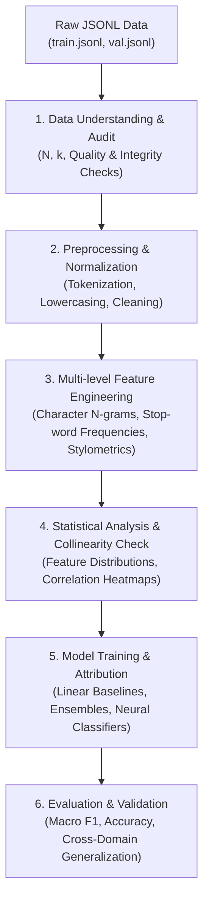

# PAN Authorship Attribution & Generative AI Detection

This repository contains the end-to-end framework for authorship attribution and generative AI text detection, based on the **PAN 2025 Shared Task 1** dataset.

---

## 1. System Pipeline Architecture



---

## 2. Literature Review Comparison Matrix (Point 11)

| Paper / Framework | Extracted Feature Space | Classifier / Model | Target Problem | Limitations / Gaps |
| :--- | :--- | :--- | :--- | :--- |
| **Stamatatos (2009, 2013)** | Character 3-to-5-grams, punctuation frequencies | SVM, Ensemble Classifiers | Traditional closed-set Authorship Attribution | High feature dimensionality; sensitive to domain shifts |
| **Koppel et al. (2011)** | Unmasking with iterative chunk degradation | Repeated Linear SVM | Authorship Verification (open-set 1 vs 1) | Requires long texts; computationally expensive |
| **Barlas & Stamatatos (2020)** | Fine-tuned contextual embeddings (BERT, RoBERTa) | Neural Cross-Entropy Classification | Cross-topic Authorship Attribution | Opaque decision boundaries; vulnerable to topic confounding |
| **Our Implementation** | Multi-level Stylometry (TTR, Punctuation Density, Length Variance) + Character/Word N-grams | Interpretable Scalable Baselines & Tree Ensembles | PAN 2025 Generative AI Detection & Model Attribution | Combines computational efficiency with high stylometric interpretability |

---

## 3. Dataset Dimensions & Inspection (Points 1, 2, 8)

| Split | Records ($N$) | Classes ($k_{labels}$) | Candidate Authors / Models ($k_{models}$) | Domains ($k_{genres}$) |
| :--- | :--- | :--- | :--- | :--- |
| **Train** | 23,707 | 2 (Human: 9,101; AI: 14,606) | 23 (Human + 22 AI models) | 3 (Fiction: 14,697; Essays: 4,661; News: 4,349) |
| **Validation** | 3,589 | 2 (Human: 1,379; AI: 2,210) | 23 (Human + 22 AI models) | 3 (Fiction: 2,226; Essays: 706; News: 657) |
| **Total** | **27,296** | **2** | **23** | **3** |

### Data Quality & Integrity (Points 3, 4, 12)
- **Corrupted Lines (JSON errors)**: 0
- **Missing Required Fields (`id`, `text`, `model`, `label`, `genre`)**: 0
- **Empty / Whitespace Texts**: 0
- **Duplicate Record IDs**: 0
- **Word Count Range**: 33 to 4,892 words (Mean: 621.2 words)
- **Data Integrity Status**: **EXCELLENT**

---

## 4. Key Exploratory Stylometric Findings (Points 10, 11)

| Stylometric Metric | Human Written ($y=0$) | AI-Generated ($y=1$) | Stylistic Interpretation |
| :--- | :--- | :--- | :--- |
| **Mean Word Count** | **710.95** | **584.47** | Human texts are structurally longer and show higher variance |
| **Mean Character Count** | **3,941.83** | **3,580.48** | Corresponds to longer narrative passages in human fiction |
| **Type-Token Ratio (TTR)** | **0.4714** | **0.5224** | AI models exhibit higher vocabulary diversity per segment |
| **Punctuation Density** | **0.0375** | **0.0284** | Humans use **~32% more punctuation** (dialogue, dashes, parentheses) |
| **Average Word Length** | **4.342 chars** | **5.023 chars** | AI outputs feature slightly longer Latinate/formal lexical items |

---

## 5. Repository Structure

```
pan-authorship-attribution/
├── data/
│   └── raw/
│       └── pan25-generative-ai-detection-task1-train/
│           ├── train.jsonl
│           └── val.jsonl
├── notebooks/
│   └── 01_exploratory_analysis.ipynb   # Interactive Jupyter EDA & Presentation
├── reports/
│   ├── 01_data_understanding_report.md
│   ├── 02_baseline_feature_extraction_report.md
│   ├── 03_advanced_derivation_report.md
│   ├── 04_feature_distributions_point10_report.md
│   └── figures/                        # Exported publication-ready figures
│       ├── class_balance_binary.png
│       ├── class_balance_authors.png
│       ├── class_balance_genres.png
│       ├── text_length_distribution.png
│       ├── stylometric_distributions.png
│       ├── top_ngrams_comparison.png
│       ├── correlation_heatmap.png
│       ├── feature_distributions_entire_dataset.png
│       └── feature_distributions_by_author.png
├── src/
│   ├── __init__.py
│   ├── data_utils.py                   # Data ingestion, inspection & quality audit
│   ├── feature_extraction.py           # Multi-level stylometric & baseline vectorizer
│   ├── visualization.py                # Publication-quality charts & EDA visualizers
│   └── main.py                         # Complete pipeline orchestrator
├── requirements.txt
└── README.md
```

---

## 6. How to Run the Analysis

To execute the pipelines and generate all deliverables:

```bash
# Activate your environment
source .venv/bin/activate

# Run Point 10: Feature Distributions Across Dataset & Authors
python src/main.py --stage 10

# Run Point 13: Advanced Feature Derivation & Collinearity Matrix
python src/main.py --stage 3

# Run Stage 2: Baseline Vector Space Feature Extraction
python src/main.py --stage 2

# Run the complete end-to-end pipeline (All Stages & Points)
python src/main.py --stage all
```

To run individual data utility checks:

```bash
python src/data_utils.py
```
