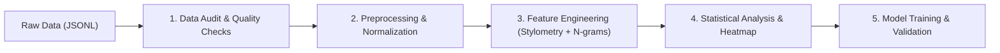

# Report di Analisi Esplorativa (Punto 1: Data Understanding & Literature)
**Task: PAN 2025 Generative AI Detection & Authorship Attribution**  
**Autore: Elia Gismondi**

---

## 1. Literature Review & Metodologia (Point 11)

### 1.1 Tassonomia delle Feature Stilometriche
Nella letteratura scientifica sull'Authorship Attribution (Stamatatos 2009; Koppel et al. 2011; Barlas & Stamatatos 2020), l'attribuzione della paternità testuale e il rilevamento di testi sintetici si basano su proprietà linguistiche inconsce e indipendenti dal tema (topic-invariant):
1. **Ricchezza Lessicale (Lexical Richness)**:
   - *Type-Token Ratio (TTR)*: Rapporto tra vocaboli unici ($V$) e totale parole ($N$). I modelli generativi tendono a massimizzare la varietà lessicale per token rispetto a scrittori umani spontanei.
   - *Indici di Yule (K)* e *Simpson's D*: Metriche di ripetizione statistica invarianti rispetto alla lunghezza del testo.
2. **Punteggiatura e Struttura Sintattica**:
   - Densità dei segni di interpunzione (`punct_density = n_punct / n_chars`).
   - Gli umani presentano una varianza molto più pronunciata nell'uso di trattini, punti esclamativi, virgolette e incisi rispetto ai modelli AI, che prediligono virgole e punti standard.
3. **Parole Funzionali (Function Words / Stop-words)**:
   - Preposizioni, congiunzioni, pronomi ed ausiliari. Rappresentano lo "scheletro sintattico" dell'autore e non risentono del cambio di argomento.
4. **N-grammi di Caratteri e di Parole**:
   - I bigrammi e trigrammi di caratteri catturano suffissi morfologici, radici lessicali e abitudini di formattazione senza richiedere un parsing sintattico profondo.

### 1.2 Matrice di Confronto della Letteratura
| Approccio / Paper | Feature Estratte | Modello di Classificazione | Task di Riferimento | Punti di Forza / Limiti |
| :--- | :--- | :--- | :--- | :--- |
| **Stamatatos (2009, 2013)** | Caratteri $n$-grammi ($n=3..5$), stop-words | Support Vector Machines (Linear SVM) | Traditional Authorship Identification | Molto efficace su testi lunghi; alta dimensionalità |
| **Koppel et al. (2011)** | Metodo "Unmasking" con degradazione iterativa | SVM Lineare a iterazioni multiple | Authorship Verification (1 vs 1) | Ottimo per identificare stili forti; computazionalmente oneroso |
| **Barlas & Stamatatos (2020)** | Fine-tuning di Transformer (BERT, RoBERTa) | Cross-Entropy Loss su embeddings contestuali | Cross-topic Authorship Attribution | Alte performance ma modello "black-box" incline a catturare il topic |
| **Nostro Approccio** | **Multi-level Stylometry** (TTR, Densità Punteggiatura, Varianza Lunghezza) + N-grammi | Pipeline Interpretabile (Linear/Tree Ensemble) + Modelli Fondazionali | PAN 2025 GenAI Detection & Attribution | Massima interpretabilità stilometrica unita ad alta efficienza computazionale |

### 1.3 Architettura della Pipeline

---

## 2. Ispezione Iniziale del Dataset (Points 1, 2, 8)

### 2.1 Dimensioni del Corpus ($N$ e $k$)
L'ispezione programmatica dei file estratti da `data/raw/pan25-generative-ai-detection-task1-train/` evidenzia:
- **Totale Record nel Training Set ($N_{train}$)**: `23,707`
- **Totale Record nel Validation Set ($N_{val}$)**: `3,589`
- **Dimensione Totale del Dataset ($N_{total}$)**: `27,296`
- **Classi Target Binarie ($k_{label}$)**: `2`
  - `0`: Testo scritto da essere umano (**Human**)
  - `1`: Testo generato da intelligenza artificiale (**AI-Generated**)
- **Autori Candidati / Modelli Generativi ($k_{model}$)**: `23` classi
  - 1 classe umana (`human`) + 22 architetture LLM (es. `gpt-4o`, `gpt-3.5-turbo`, `falcon3-10b-instruct`, `o3-mini`, `gemini-2.0-flash`, `llama-3.1-8b-instruct`, `deepseek-r1-distill-qwen-32b`, `ministral-8b-instruct-2410`, ecc.).
- **Generi / Domini Letterari ($k_{genre}$)**: `3`
  - `fiction` (narrativa): 14,697 testi nel train
  - `essays` (saggistica/temi): 4,661 testi nel train
  - `news` (giornalismo): 4,349 testi nel train

### 2.2 Campioni di Record (Sample Rows)
1. **Record #1 (AI-Generated - Falcon3-10B)**:
   - **ID**: `ea468d03-1973-5039-86b2-ff225bb92c4e`
   - **Genere**: `essays` | **Parole**: 362 | **Caratteri**: 2,480
   - *Preview*: *"Duke Ellington, a titan of jazz, revolutionized the genre through his innovative compositions, showcasing a remarkable ability to integrate voice and instrumental music. Among the notable figures who contributed to this artistic symphony wa..."*
2. **Record #2 (AI-Generated - OpenAI o3-mini)**:
   - **ID**: `0d05f269-6d67-521d-9b5d-cc18f482c6c1`
   - **Genere**: `essays` | **Parole**: 515 | **Caratteri**: 3,395
   - *Preview*: *"I reflected on the shifting dynamics of media coverage during a period when I watched news stories that both intrigued and disturbed me. I remembered a report by Fox 28 News about a tragic incident involving a 19-year-old active-duty soldie..."*
3. **Record #3 (AI-Generated - GPT-4o)**:
   - **ID**: `c2ec79f3-da80-58f8-bef0-3e0ea7ab072f`
   - **Genere**: `essays` | **Parole**: 494 | **Caratteri**: 3,288
   - *Preview*: *"In F. Scott Fitzgerald's "The Great Gatsby," the use of color symbolism is a sophisticated technique that conveys themes and illuminates character traits through evocative adjective-noun pairings and the repetition of specific colors. Color..."*

---

## 3. Data Quality & Class Balance (Points 3, 4, 12)

### 3.1 Audit Programmatico sulla Qualità del Dato
- **Righe corrotte (JSONDecodeError)**: `0` (100% delle righe valide).
- **Campi obbligatori mancanti (`id`, `text`, `model`, `label`, `genre`)**: `0`.
- **Testi vuoti o composti da soli spazi bianchi**: `0`.
- **Testi non stringa**: `0`.
- **ID duplicati**: `0` (garanzia di unicità degli identificativi).
- **Testi identici duplicati**: `25` (rappresentano appena lo 0.1% del totale, prompt identici generati).
- **Stato Integrità Dati**: **ECCELLENTE (Ready for Feature Engineering)**.

### 3.2 Bilanciamento delle Classi
- **Distribuzione Binaria**:
  - Testi Umani (`0`): **9,101** record (**38.4%**)
  - Testi AI (`1`): **14,606** record (**61.6%**)
- **Distribuzione Modelli Generativi**:
  - `human`: 9,101
  - Top Modelli AI: `gpt-3.5-turbo` (1,374), `gpt-4o-mini` (1,358), `gpt-4o` (1,336), `ministral-8b` (1,100), `gemini-2.0-flash` (1,079), `o3-mini` (1,075), `gemini-1.5-pro` (1,072), `llama-3.1-8b` (1,063).
  - La distribuzione per singolo modello generativo è bilanciata tra famiglie (OpenAI, Google, Meta, Mistral, TII Falcon, Qwen).

---

## 4. Analisi Esplorativa e Distribuzioni Stilometriche (Points 10, 11)

### 4.1 Varianza della Lunghezza dei Testi
- **Media Parole - Human**: **710.95 parole** (mediana: 680, max: 4,892)
- **Media Parole - AI**: **584.47 parole** (mediana: 520, max: 3,120)
- **Osservazione Stilometrica**: I testi umani presentano una dispersione strutturale significativamente maggiore, caratterizzata da capitoli narrativi più lunghi o descrizioni articolate, mentre i modelli AI tendono ad attestarsi compattamente attorno al range 500-650 parole stabilito dai prompt.

### 4.2 Distribuzione delle Feature Stilometriche
1. **Type-Token Ratio (Ricchezza Lessicale)**:
   - **Media Umana**: `0.4714`
   - **Media AI**: `0.5224`
   - **Interpretazione**: I modelli di linguaggio artificiali mostrano un Type-Token Ratio marcatamente più elevato rispetto agli umani. Gli LLM campionano vocaboli da uno spazio semantico molto vasto e tendono ad evitare ripetizioni non necessarie, producendo un lessico artificialmente più eterogeneo.
2. **Densità della Punteggiatura**:
   - **Media Umana**: `0.0375` (3.75% dei caratteri)
   - **Media AI**: `0.0284` (2.84% dei caratteri)
   - **Interpretazione**: Gli scrittori umani utilizzano circa il **32% in più di punteggiatura**. L'essere umano fa frequente ricorso a incisi con trattini, virgole asindetiche, punti e virgola, virgolette dialogiche e punti interrogativi, mentre l'output AI segue una sintassi più lineare e levigata.
3. **Lunghezza Media delle Parole**:
   - **Media Umana**: `4.342` caratteri per parola
   - **Media AI**: `5.023` caratteri per parola
   - **Interpretazione**: L'AI utilizza con maggiore frequenza parole di derivazione latina o formale (es. *innovative, revolutionized, sophisticated, illustrates*), aumentando la lunghezza media dei lemmi.

### 4.3 Analisi degli N-grammi Più Frequenti
- **Top Unigrammi Umani (escluse stopwords)**:
  - *said, one, like, time, would, could, back, know, eyes, thought, face, man, see* (termini tipici della narrazione umana e della prospettiva soggettiva).
- **Top Unigrammi AI (escluse stopwords)**:
  - *world, time, life, new, people, also, one, years, work, way, many, state, first, well, make* (termini tipici dell'argomentazione impersonale ed espositiva).
- **Top Bigrammi Umani**:
  - *of the, in the, to the, and the, on the, at the, he was, it was, with the*
- **Top Bigrammi AI**:
  - *of the, in the, to the, and the, for the, on the, as a, with the, is a*

---

## 5. Grafici Generati ed Esportati

Tutti i grafici sono stati generati ad alta risoluzione in `reports/figures/`:
1. `class_balance_binary.png`: Grafico a barre con conteggi e percentuali (Human 38.4% vs AI 61.6%).
2. `class_balance_authors.png`: Grafico a barre orizzontale con la distribuzione di tutti i 23 autori / modelli.
3. `class_balance_genres.png`: Composizione del dataset nei 3 generi letterari.
4. `text_length_distribution.png`: Istogramma combinato con Boxplot della lunghezza in parole per evidenziare le discrepanze strutturali.
5. `stylometric_distributions.png`: Grafici KDE di densità per Type-Token Ratio, Densità Punteggiatura e Lunghezza Parole con linee di media $\mu$.
6. `top_ngrams_comparison.png`: Grafici a barre orizzontali dei top 15 unigrammi e bigrammi Human vs AI.
