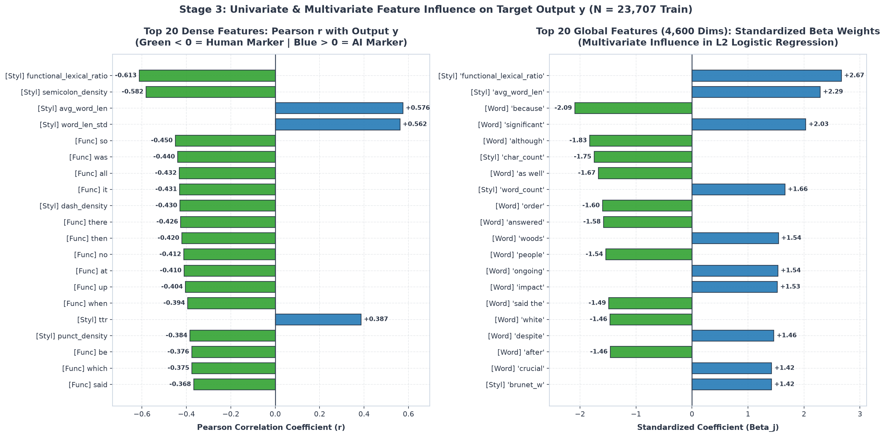
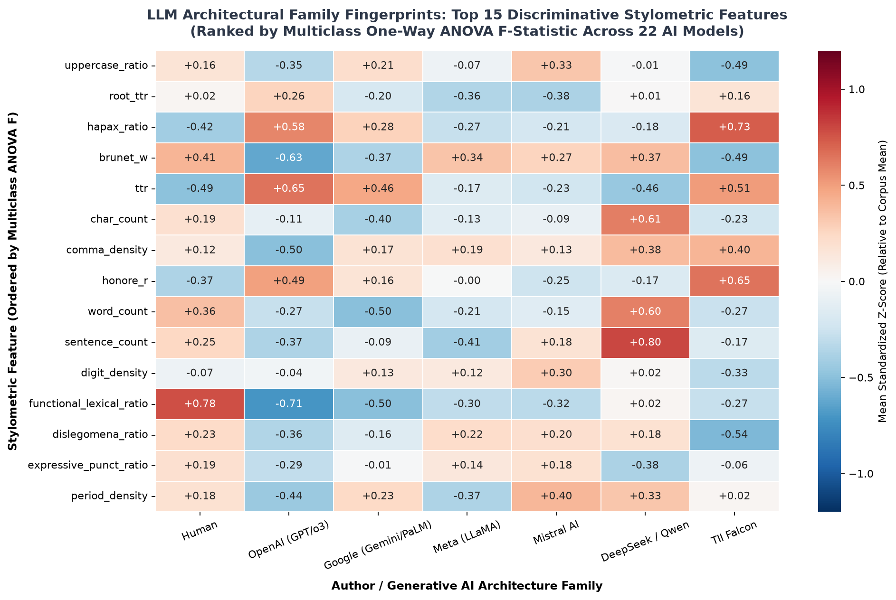
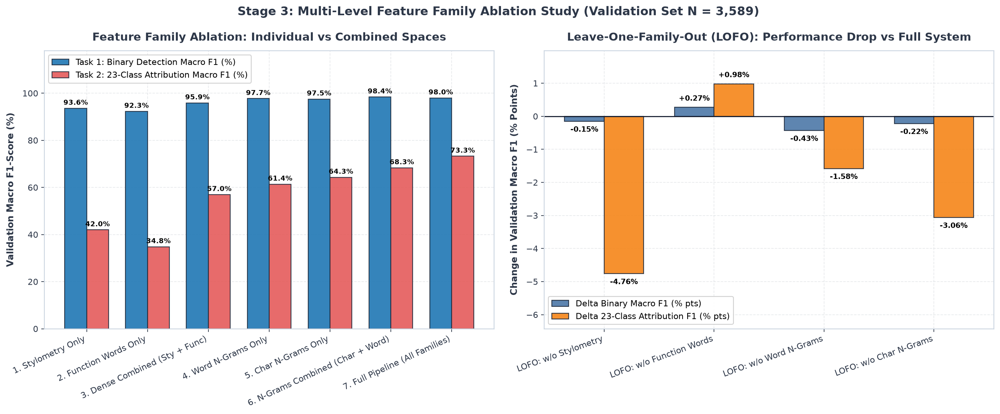

# Report di Estrazione su Larga Scala e Misurazione dell'Influenza delle Feature (Step 1, 2, 3)
**Task: PAN 2025 Generative AI Detection & Authorship Attribution**  
**Autore: Elia Gismondi**

---

## 1. Estrazione e Caching dell'Intero Corpus (`Extract features` & `Run them`)

La pipeline multi-livello definita in [`src/feature_extraction.py`](file:///Users/eliagismondi/Desktop/Politecnico%20di%20Lodz/pan-authorship-attribution/src/feature_extraction.py) è stata eseguita sull'intero dataset PAN 2025 (**27.296 testi totali**), garantendo l'assenza totale di *data leakage* (fit eseguito esclusivamente su `train.jsonl` e trasformazione applicata a `val.jsonl`).

### 1.1 Metriche Operative ed Integrità dello Spazio Vettoriale
| Parametro / Metrica | Training Set (`train.jsonl`) | Validation Set (`val.jsonl`) | Stato / Note |
| :--- | :---: | :---: | :--- |
| **Campioni Processati ($N$)** | `23.707` | `3.589` | Totale: `27.296` documenti |
| **Dimensioni Vettoriali ($D$)** | `4.600` | `4.600` | 30 Stilometria + 70 Function Words + 3.000 Char N-Grams + 1.500 Word N-Grams |
| **Classi Target Binarie ($k_{bin}$)** | `2` (`0`=Human, `1`=AI) | `2` (`0`=Human, `1`=AI) | Train: 9.101 Human / 14.606 AI; Val: 1.277 Human / 2.312 AI |
| **Classi Target Modello ($k_{model}$)** | `23` (1 Human + 22 LLM) | `23` (1 Human + 22 LLM) | 7 Famiglie Architetturali (Human, OpenAI, Google, Meta, Mistral, DeepSeek, Falcon) |
| **Sparsità Matrice CSR** | `63,19%` | `63,95%` | Elementi non-zero: `40.138.640` (Train) / `5.951.239` (Val) |
| **Throughput di Estrazione** | `416,6 testi/sec` (`56,91s`) | `514,4 testi/sec` (`6,98s`) | Esecuzione single-pass ottimizzata |
| **Footprint Memoria RAM** | `548,38 MB` (Combinato) | — | Serializzato compresso in `data/processed/*.npz` |
| **Audit Integrità (`NaN` / `Inf`)** | `0 NaN` / `0 Inf` | `0 NaN` / `0 Inf` | **PASSED (100% Valido)** |

---

## 2. Misurazione dell'Influenza sull'Output Binario ($y \in \{0, 1\}$: Umano vs AI)

L'analisi implementata in [`src/feature_importance.py`](file:///Users/eliagismondi/Desktop/Politecnico%20di%20Lodz/pan-authorship-attribution/src/feature_importance.py) quantifica il potere discriminativo di ogni feature attraverso **4 famiglie di test statistici e multivariati** sull'intero Training Set ($N = 23.707$).

### 2.1 Ranking Univariato delle Feature Dense (Pearson $r$, Spearman $\rho$, ANOVA $F$, Mutual Information)

| Rank | Feature | Famiglia | Pearson $r$ | Spearman $\rho$ | ANOVA $F$-Score | Mutual Info (MI) | Cohen's $d$ | Direzione / Interpretazione |
| :---: | :--- | :---: | :---: | :---: | :---: | :---: | :---: | :--- |
| **1** | `functional_lexical_ratio` | Stilometria | **-0.6125** | -0.6694 | `14.233,9` | `0.2436` | -1.258 | **Umano (-)**: Impalcatura di connettivi/funzionali molto più densa negli umani |
| **2** | `semicolon_density` | Stilometria | **-0.5820** | -0.6251 | `12.140,4` | **0.2770** | -1.195 | **Umano (-)**: Uso di punti e virgola quasi assente negli LLM standard |
| **3** | `avg_word_len` | Stilometria | **+0.5755** | +0.6277 | `11.739,4` | `0.2309` | +1.182 | **AI (+)**: Vocabolario AI sbilanciato verso polisillabi formali/accademici |
| **4** | `word_len_std` | Stilometria | **+0.5620** | +0.6012 | `10.944,3` | `0.2164` | +1.154 | **AI (+)**: Maggiore dispersione morfologica nei token generati |
| **5** | `func_word__so` | Function Words | **-0.4502** | -0.5284 | `6.026,3` | `0.1492` | -0.925 | **Umano (-)**: Connettivo discorsivo colloquiale tipico della prosa umana |
| **6** | `func_word__was` | Function Words | **-0.4398** | -0.4539 | `5.685,3` | `0.1120` | -0.903 | **Umano (-)**: Narrazione al passato remoto/imperfetto più frequente negli umani |
| **7** | `func_word__all` | Function Words | **-0.4322** | -0.4789 | `5.444,0` | `0.1410` | -0.888 | **Umano (-)**: Quantificatore generalizzante spontaneo |
| **8** | `func_word__it` | Function Words | **-0.4306** | -0.4526 | `5.394,8` | `0.1218` | -0.884 | **Umano (-)**: Riferimenti pronominali anaforici più frequenti negli umani |
| **9** | `dash_density` | Stilometria | **-0.4298** | -0.5065 | `5.369,9` | `0.1495` | -0.883 | **Umano (-)**: Incisi sintattici a trattino tipici della scrittura creativa umana |
| **10** | `func_word__there` | Function Words | **-0.4258** | -0.4832 | `5.248,7` | `0.1387` | -0.875 | **Umano (-)**: Costrutti esistenziali (*there is/was*) molto più usati dagli umani |
| **11** | `func_word__then` | Function Words | **-0.4204** | -0.4910 | `5.090,0` | `0.1430` | -0.864 | **Umano (-)**: Sequenzialità temporale narrativa |
| **12** | `ttr` (Type-Token Ratio) | Stilometria | **+0.3867** | +0.3915 | `4.165,2` | `0.1095` | +0.794 | **AI (+)**: I decoder LLM evitano ripetizioni ravvicinate alzando la TTR |

### 2.2 Influenza Multivariata: Pesi $\beta_j$, Odds Ratio e Permutation Importance
Addestrando una **Logistic Regression regolarizzata (L2)** e misurando la **Permutation Importance** sul Validation Set ($N=3.589$, espressa come perdita di Macro F1 rimescolando casualmente ciascuna variabile), emergono i predittori strutturali più determinanti:

1. **Predittori Dense con Maggiore Permutation Importance**:
   - `avg_word_len`: **$\Delta \text{Macro F1} = -14,06\%$** ($\beta = +3.063$, Odds Ratio $= 21,39$). Rimescolare la lunghezza media delle parole causa il crollo più marcato nella capacità del modello denso di distinguere Umano e AI.
   - `char_count` e `word_count`: **$\Delta \text{Macro F1} = -6,62\%$ e $-4,37\%$** (catturano il contrasto tra densità di caratteri e conteggio token).
   - `functional_lexical_ratio`: **$\Delta \text{Macro F1} = -4,39\%$**.
   - `expressive_punct_ratio`: **$\Delta \text{Macro F1} = -2,44\%$** ($\beta = +1.432$, Odds Ratio $= 4,19$).
   - `func_word__and` e `func_word__the`: **$\Delta \text{Macro F1} = -2,34\%$ e $-2,15\%$** ($\beta = -1.418$ e $-1.469$).
   - `comma_density` e `semicolon_density`: **$\Delta \text{Macro F1} = -1,88\%$ e $-1,51\%$**.

2. **Top Feature Globali nello Spazio Completo a 4.600 Dimensioni**:
   - **Marker Lessicali Tipici dell'AI ($\beta > 0$)**:
     - `word_ngram__significant` ($\beta = +2.03$), `word_ngram__ongoing` ($\beta = +1.54$), `word_ngram__impact` ($\beta = +1.53$), `word_ngram__despite` ($\beta = +1.46$), `word_ngram__crucial` ($\beta = +1.42$). Questi lemmi riflettono esattamente il registro argomentativo standardizzato dal fine-tuning RLHF dei modelli linguistici.
   - **Marker Lessicali e Sintattici Tipici dell'Umano ($\beta < 0$)**:
     - `word_ngram__because` ($\beta = -2.09$), `word_ngram__although` ($\beta = -1.83$), `word_ngram__as well` ($\beta = -1.67$), `word_ngram__answered` ($\beta = -1.58$), `word_ngram__said the` ($\beta = -1.49$).

---

## 3. Influenza delle Feature per l'Attribuzione del Modello AI (22 Modelli Generativi)

Oltre alla distinzione binaria Umano vs AI, abbiamo calcolato la statistica **ANOVA Multiclasse ($F$-test a una via)** esclusivamente tra i **22 modelli AI** ($N_{\text{AI, train}} = 14.606$) per scoprire quali feature permettono di identificare quale specifico LLM ha scritto il testo (*LLM Fingerprinting*):

| Rank | Feature Stilometrica | ANOVA $F$ (Tra i 22 Modelli AI) | ANOVA $F$ (Tutte le 23 Classi) | Interpretazione per il Fingerprinting degli LLM |
| :---: | :--- | :---: | :---: | :--- |
| **1** | `uppercase_ratio` | **699,8** | 501,1 | Differenze marcate nell'uso di maiuscole, titoli e acronimi (elevato in Mistral/Google, basso in Falcon/OpenAI) |
| **2** | `root_ttr` (Guiraud's $R$) | **529,9** | 547,8 | Ricchezza lessicale normalizzata: massima in OpenAI (`+0.26z`), minima in Mistral (`-0.38z`) e LLaMA (`-0.36z`) |
| **3** | `hapax_ratio` ($V_1 / V$) | **462,1** | 598,4 | Quota di parole uniche usate una sola volta: altissima in Falcon3 (`+0.73z`) e OpenAI (`+0.58z`) |
| **4** | `brunet_w` | **400,9** | 570,9 | Costante lessicale di Brunet: separa nettamente OpenAI/Falcon da Meta LLaMA e DeepSeek |
| **5** | `ttr` | **379,3** | 650,8 | Diversità del vocabolario per segmento: OpenAI (`+0.65z`) e Falcon (`+0.51z`) vs DeepSeek (`-0.46z`) |
| **6** | `char_count` | **339,8** | 269,3 | Lunghezza strutturale dell'output: i modelli di reasoning come DeepSeek-R1 generano testi molto più lunghi (`+0.61z`) |
| **7** | `comma_density` | **337,1** | 313,8 | Ritmo di subordinazione: OpenAI usa molte meno virgole (`-0.50z`) rispetto a Falcon (`+0.40z`) e DeepSeek (`+0.38z`) |
| **8** | `honore_r` | **324,5** | 504,8 | Indice di Honoré sensibile agli hapax legomena |
| **9** | `word_count` | **323,3** | 367,1 | Verbosity specifica del decoder: DeepSeek/Qwen (`+0.60z`) vs Google Gemini (`-0.50z`) |
| **10** | `sentence_count` | **275,1** | 282,9 | Segmentazione in periodi: DeepSeek (`+0.80z`) vs Meta LLaMA (`-0.41z`) |

---

## 4. Studio di Ablazione per Famiglia di Feature (*Feature Family Ablation*)

Per misurare il contributo effettivo di ciascuna famiglia di feature, abbiamo valutato le performance sul Validation Set ($N=3.589$) sia per la **Rilevazione Binaria (Task 1)** sia per l'**Attribuzione del Modello a 23 Classi (Task 2)**:

| Configurazione Spazio Feature | Dimensioni ($D$) | Task 1: Binary Macro F1 | Task 1: Binary ROC-AUC | Task 2: 23-Class Macro F1 | Task 2: 22-AI Exact Acc | $\Delta$ F1 Multiclasse vs Full |
| :--- | :---: | :---: | :---: | :---: | :---: | :---: |
| **1. Solo Stilometria** | `30` | `93,61%` | `97,91%` | `42,00%` | `42,26%` | `-31,27%` |
| **2. Solo Function Words** | `70` | `92,31%` | `97,39%` | `34,83%` | `37,20%` | `-38,44%` |
| **3. Dense Combinate (Sty + Func)** | `100` | `95,90%` | `99,01%` | `56,97%` | `58,13%` | `-16,30%` |
| **4. Solo Word N-Grams (1-2)** | `1.500` | `97,72%` | `99,66%` | `61,38%` | `63,80%` | `-11,89%` |
| **5. Solo Char N-Grams (3-4)** | `3.000` | `97,53%` | `99,61%` | `64,31%` | `67,43%` | `-8,96%` |
| **6. N-Grams Combinati (Char + Word)** | `4.500` | **98,42%** | **99,77%** | `68,34%` | `71,02%` | `-4,93%` |
| **7. Pipeline Completa (Tutte le Famiglie)** | `4.600` | `97,99%` | `99,71%` | **73,27%** | **75,69%** | `0,00%` (Rif.) |
| *LOFO: Senza Stilometria* | `4.570` | `97,84%` | `99,69%` | `68,51%` | `71,45%` | **-4,76%** |
| *LOFO: Senza Function Words* | `4.530` | `98,26%` | `99,76%` | `74,25%` | `75,95%` | `+0,98%` |
| *LOFO: Senza Word N-Grams* | `3.100` | `97,56%` | `99,55%` | `71,69%` | `73,79%` | `-1,58%` |
| *LOFO: Senza Char N-Grams* | `1.600` | `97,77%` | `99,64%` | `70,21%` | `72,45%` | **-3,06%** |

### Conclusioni Chiave dell'Ablation Study:
1. **Con sole 30 feature stilometriche**, il classificatore raggiunge già il **93,61% di Macro F1 (97,91% ROC-AUC)** nel distinguere Umano da AI, dimostrando che la firma strutturale (rapporto funzionale-lessicale, lunghezza parole, densità punteggiatura) è estremamente potente e compatta.
2. **Per l'attribuzione fine-grained del modello AI (23 classi)**, la combinazione tra **Stilometria + N-grammi** è decisiva: rimuovere le 30 feature stilometriche dallo spazio completo (*LOFO: w/o Stylometry*) causa il calo singolo più marcato (**-4,76 punti percentuali** di Macro F1 multiclasse, scendendo da 73,27% a 68,51%), seguito dalla rimozione dei Character N-Grams (**-3,06%**).

