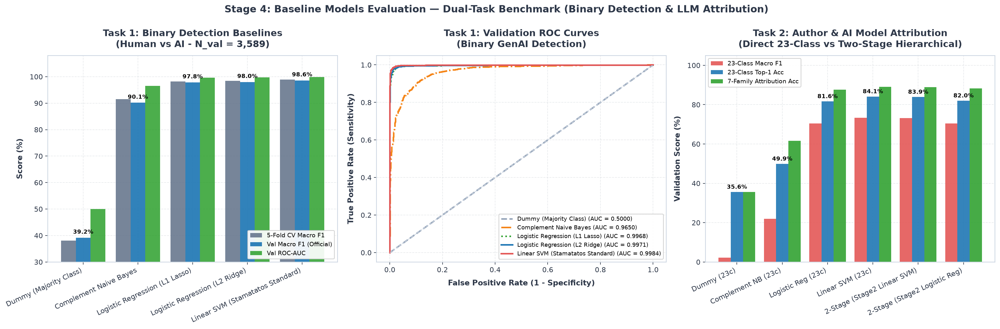
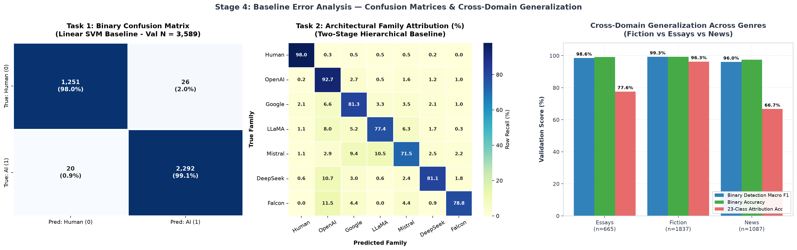
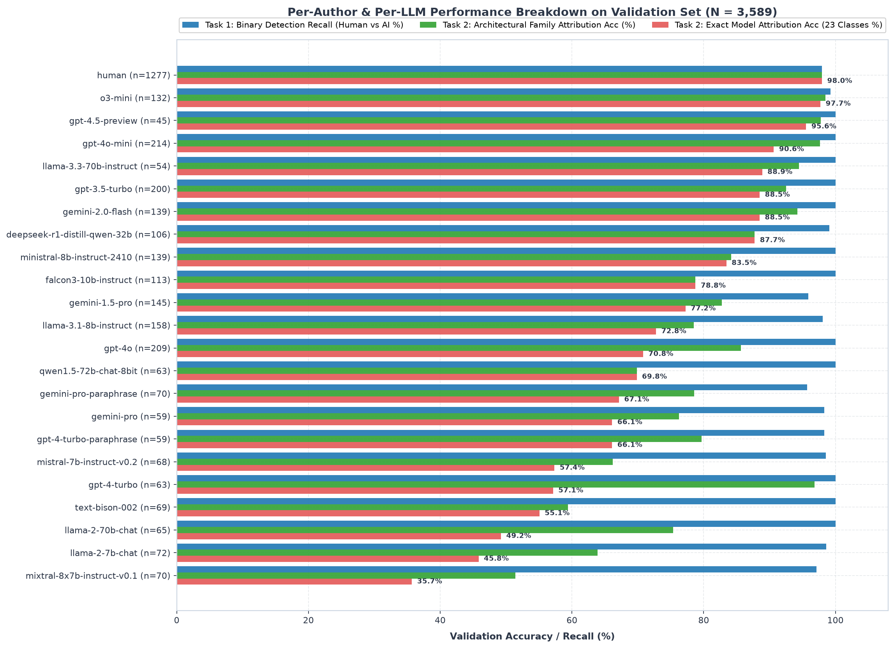

# Report di Valutazione dei Modelli Baseline — Dual-Task (Step 4: Run the Baseline Model)
**Task: PAN 2025 Generative AI Detection & Authorship Attribution**  
**Autore: Elia Gismondi**

---

## 1. Architettura Dual-Task dei Modelli Baseline

In conformità con le indicazioni della professoressa e della letteratura PAN (Stamatatos 2009; Koppel et al. 2011), il modulo [`src/baseline_models.py`](file:///Users/eliagismondi/Desktop/Politecnico%20di%20Lodz/pan-authorship-attribution/src/baseline_models.py) implementa e confronta i modelli di baseline su **due livelli di predizione**:
1. **Task 1 — Binary Generative AI Detection ($k = 2$)**: Determinare se un testo è stato scritto da un essere umano (`0`) o generato da un modello AI (`1`).
2. **Task 2 — Authorship & LLM Model Attribution ($k = 23$)**: Identificare non solo se il testo è umano o artificiale, ma **quale specifico modello AI** (tra le 22 architetture candidate nel corpus) ha generato il testo, confrontando:
   - **Classificazione Multiclasse Diretta a 23 Classi** (`human` + 22 LLM).
   - **Pipeline Gerarchica a Due Stadi (*Two-Stage Hierarchical Attribution*)**:
     - *Stadio 1 (Detector)*: Filtra i testi umani da quelli sintetici.
     - *Stadio 2 (LLM Fingerprinter)*: Classificatore specializzato addestrato esclusivamente sui 22 modelli AI per attribuire il modello generativo esatto ai testi flaggati come sintetici.

---

## 2. Risultati Task 1: Rilevazione Binaria (Umano vs AI)

Tutti i modelli sono stati validati tramite **5-Fold Stratified Cross-Validation** sul Training Set ($N = 23.707$) e testati sull'official **Validation Set ($N = 3.589$: 1.277 Human, 2.312 AI)**.

| Modello Baseline | 5-Fold CV Macro F1 | Val Macro F1 (Ufficiale) | Val Accuracy | Val Balanced Acc | F1 Human (`y=0`) | F1 AI (`y=1`) | Val ROC-AUC | Falsi Positivi (FP) | Falsi Negativi (FN) | Tempo Fit |
| :--- | :---: | :---: | :---: | :---: | :---: | :---: | :---: | :---: | :---: | :---: |
| **Dummy (Majority Class)** | `38,12 ± 0,00%` | `39,18%` | `64,42%` | `50,00%` | `0,00%` | `78,36%` | `50,00%` | 1.277 | 0 | `0,00s` |
| **Complement Naive Bayes** | `91,55 ± 0,12%` | `90,15%` | `91,03%` | `89,92%` | `87,22%` | `93,09%` | `96,50%` | 178 | 144 | `0,04s` |
| **Logistic Regression (L1 Lasso)** | `98,20 ± 0,27%` | `97,84%` | `98,02%` | `97,71%` | `97,20%` | `98,47%` | `99,68%` | 43 | 28 | `4,93s` |
| **Logistic Regression (L2 Ridge)** | `98,45 ± 0,20%` | `97,99%` | `98,16%` | `97,87%` | `97,40%` | `98,58%` | `99,71%` | 40 | 26 | `5,44s` |
| **Linear SVM (Stamatatos Standard)** | **`98,88 ± 0,15%`** | **`98,60%`** | **`98,72%`** | **`98,55%`** | **`98,19%`** | **`99,01%`** | **`99,84%`** | **26** | **20** | `4,88s` |

### Analisi dei Risultati Binari:
- Il **Linear SVM (`LinearSVC`)** conferma il suo primato storico nella letteratura stilometrica (Stamatatos 2009), raggiungendo un **Macro F1 del 98,60%** e un **ROC-AUC del 99,84%** sul Validation Set, commettendo appena **46 errori totali su 3.589 testi** (26 falsi positivi e 20 falsi negativi).
- Le regressioni logistiche **L2 Ridge (97,99% Macro F1)** e **L1 Lasso (97,84% Macro F1)** offrono prestazioni quasi identiche con probabilità calibrate native e pesi $\beta$ direttamente interpretabili.

---

## 3. Risultati Task 2: Model Attribution (Quale Modello AI ha scritto il testo?)

La tabella seguente mostra la capacità dei modelli di identificare l'autore esatto tra **23 classi** (`human` + 22 LLM), l'accuratezza esatta sui soli **22 modelli AI**, e l'accuratezza per **Famiglia Architetturale (7 famiglie: Human, OpenAI, Google Gemini, Meta LLaMA, Mistral, DeepSeek/Qwen, TII Falcon)**:

| Modello / Architettura | Tipo Pipeline | 23-Class Macro F1 | 23-Class Top-1 Acc | 23-Class Top-3 Acc | 22-AI Exact Acc (Solo AI) | 7-Family Attribution Acc | 7-Family Macro F1 |
| :--- | :---: | :---: | :---: | :---: | :---: | :---: | :---: |
| **Dummy (Majority Class)** | Diretta (23c) | `2,28%` | `35,58%` | `39,26%` | `0,00%` | `35,58%` | `7,50%` |
| **Complement Naive Bayes** | Diretta (23c) | `22,03%` | `49,87%` | `69,46%` | `25,17%` | `61,58%` | `39,92%` |
| **Logistic Regression (Multinomial L2)** | Diretta (23c) | `70,50%` | `81,64%` | `94,59%` | `72,75%` | `87,66%` | `80,98%` |
| **Linear SVM (One-vs-Rest 23c)** | Diretta (23c) | **`73,27%`** | **`84,12%`** | **`94,93%`** | `75,69%` | **`89,05%`** | `82,96%` |
| **Two-Stage (Stage1 SVM + Stage2 Linear SVM)** | **Gerarchica 2-Stadi** | `73,13%` | `83,87%` | `93,98%` | **`76,08%`** | `88,94%` | **`83,14%`** |
| **Two-Stage (Stage1 SVM + Stage2 Logistic Reg)** | **Gerarchica 2-Stadi** | `70,51%` | `82,00%` | `94,15%` | `73,18%` | `88,30%` | `81,69%` |

### Analisi dei Risultati di Model Attribution:
1. **Altissima Capacità di Fingerprinting**: Pur dovendo distinguere tra **23 classi** (molte delle quali sono varianti della stessa famiglia, come `gpt-4o`, `gpt-4o-mini`, `gpt-4-turbo`, `gpt-4.5-preview`), il baseline **Linear SVM** e la **Pipeline Gerarchica a Due Stadi** identificano il modello esatto nell'**84,12% dei casi (Top-1)** e nel **94,93% dei casi entro le prime 3 ipotesi (Top-3)**!
2. **Superiorità dello Stadio 2 sui Testi AI**: La pipeline **Two-Stage Hierarchical (Stage 1 Binary SVM + Stage 2 Specialist SVM)** raggiunge la più alta accuratezza di attribuzione esatta sui 22 modelli AI (**76,08%**) e il miglior **Macro F1 sulle 7 famiglie architetturali (83,14%)**, poiché il classificatore di Stadio 2 dedica tutti i suoi iperpiani separatori esclusivamente alle sfumature intra-AI.
3. **Attribuzione per Famiglia di Vendor (89,05% Accuracy)**: Quasi 9 volte su 10 il modello individua correttamente la casa produttrice dell'LLM (OpenAI: `92,7%`, Human: `98,0%`, Google Gemini: `81,3%`, DeepSeek/Qwen: `81,1%`, Falcon: `78,8%`, Meta LLaMA: `77,4%`, Mistral: `71,5%`).

---

## 4. Diagnosi degli Errori: Generalizzazione Cross-Domain e Analisi per Singolo LLM

### 4.1 Generalizzazione Cross-Genre (`Fiction`, `Essays`, `News`)
Per verificare che i modelli non soffrano di *topic confounding*, abbiamo disaggregato le prestazioni del Linear SVM nei tre domini letterari del Validation Set:

| Genere / Dominio | Campioni Val ($N$) | Umani ($y=0$) | AI ($y=1$) | Binary Macro F1 | Binary Accuracy | False Positive Rate (Human $\to$ AI) | False Negative Rate (AI $\to$ Human) | 23-Class Exact Attribution Acc |
| :--- | :---: | :---: | :---: | :---: | :---: | :---: | :---: | :---: |
| **Fiction (Narrativa)** | `1.837` | 928 | 909 | **`99,29%`** | **`99,29%`** | `0,43%` (4 errori) | `0,99%` (9 errori) | **`96,30%`** |
| **Essays (Saggistica)** | `665` | 132 | 533 | **`98,57%`** | **`99,10%`** | `3,03%` (4 errori) | `0,38%` (2 errori) | `77,59%` |
| **News (Giornalismo)** | `1.087` | 217 | 870 | **`96,05%`** | **`97,52%`** | `8,29%` (18 errori) | `1,03%` (9 errori) | `66,70%` |

- **Interpretazione Forense**: Nella **Narrativa (`Fiction`)** la separazione è quasi perfetta (**99,29% Macro F1 binario e 96,30% di attribuzione esatta sui 23 modelli**), poiché la prosa narrativa umana presenta dialoghi, punteggiatura espressiva e ritmi inimitabili per gli LLM. Nel **Giornalismo (`News`)**, lo stile telegrafico e standardizzato delle agenzie stampa riduce leggermente il margine stilistico tra giornalisti umani e LLM, rendendo la distinzione intra-LLM più sfidante (`66,70%` su 23 classi, pur mantenendo un eccellente **96,05% Macro F1** nel task binario).

---

### 4.2 Prestazioni Scorporate per Singolo Autore / Modello AI (Tutti i 23 Modelli)

La tabella seguente riporta per ciascuno dei 23 candidati del Validation Set il **tasso di rilevazione binaria**, l'**accuratezza di attribuzione esatta del modello**, l'**accuratezza di famiglia** e il **modello con cui viene più frequentemente confuso**:

| Rank | Autore / Modello LLM | Famiglia | Campioni Val | Task 1: Binary Detection Acc | Task 2: Exact Model Acc (23c) | Task 2: Family Acc (7f) | Modello Più Confuso (Top Misattribution) |
| :---: | :--- | :--- | :---: | :---: | :---: | :---: | :--- |
| **1** | `human` | Human | 1.277 | **97,96%** | **97,96%** | **97,96%** | `gemini-pro-paraphrase` |
| **2** | `o3-mini` | OpenAI (GPT/o3) | 132 | **99,24%** | **97,73%** | **98,48%** | `human` (1 solo caso) |
| **3** | `gpt-4.5-preview` | OpenAI (GPT/o3) | 45 | **100,00%** | **95,56%** | **97,78%** | `gemini-1.5-pro` |
| **4** | `gpt-4o-mini` | OpenAI (GPT/o3) | 214 | **100,00%** | **90,65%** | **97,66%** | `gpt-4o` (stessa famiglia OpenAI) |
| **5** | `llama-3.3-70b-instruct` | Meta (LLaMA) | 54 | **100,00%** | **88,89%** | **94,44%** | `falcon3-10b-instruct` |
| **6** | `gpt-3.5-turbo` | OpenAI (GPT/o3) | 200 | **100,00%** | **88,50%** | **92,50%** | `gpt-4-turbo` (stessa famiglia OpenAI) |
| **7** | `gemini-2.0-flash` | Google (Gemini/PaLM) | 139 | **100,00%** | **88,49%** | **94,24%** | `gemini-1.5-pro` (stessa famiglia Google) |
| **8** | `deepseek-r1-distill-qwen-32b` | DeepSeek / Qwen | 106 | **99,06%** | **87,74%** | **87,74%** | `falcon3-10b-instruct` |
| **9** | `ministral-8b-instruct-2410` | Mistral AI | 139 | **100,00%** | **83,45%** | **84,17%** | `falcon3-10b-instruct` |
| **10** | `falcon3-10b-instruct` | TII Falcon | 113 | **100,00%** | **78,76%** | **78,76%** | `gpt-4o` |
| **11** | `gemini-1.5-pro` | Google (Gemini/PaLM) | 145 | **95,86%** | **77,24%** | **82,76%** | `human` (6 casi) |
| **12** | `llama-3.1-8b-instruct` | Meta (LLaMA) | 158 | **98,10%** | **72,78%** | **78,48%** | `ministral-8b-instruct-2410` |
| **13** | `gpt-4o` | OpenAI (GPT/o3) | 209 | **100,00%** | **70,81%** | **85,65%** | `gpt-4o-mini` (stessa famiglia OpenAI) |
| **14** | `qwen1.5-72b-chat-8bit` | DeepSeek / Qwen | 63 | **100,00%** | **69,84%** | **69,84%** | `gpt-4-turbo` |
| **15** | `gemini-pro-paraphrase` | Google (Gemini/PaLM) | 70 | **95,71%** | **67,14%** | **78,57%** | `gpt-3.5-turbo` |
| **16** | `gemini-pro` | Google (Gemini/PaLM) | 59 | **98,31%** | **66,10%** | **76,27%** | `gemini-pro-paraphrase` (stessa famiglia) |
| **17** | `gpt-4-turbo-paraphrase` | OpenAI (GPT/o3) | 59 | **98,31%** | **66,10%** | **79,66%** | `gpt-4o` (stessa famiglia OpenAI) |
| **18** | `mistral-7b-instruct-v0.2` | Mistral AI | 68 | **98,53%** | **57,35%** | **66,18%** | `mixtral-8x7b-instruct-v0.1` (stessa famiglia) |
| **19** | `gpt-4-turbo` | OpenAI (GPT/o3) | 63 | **100,00%** | **57,14%** | **96,83%** | `gpt-4o` (stessa famiglia OpenAI) |
| **20** | `text-bison-002` | Google (Gemini/PaLM) | 69 | **100,00%** | **55,07%** | **59,42%** | `mixtral-8x7b-instruct-v0.1` |
| **21** | `llama-2-70b-chat` | Meta (LLaMA) | 65 | **100,00%** | **49,23%** | **75,38%** | `llama-2-7b-chat` (stessa famiglia LLaMA-2) |
| **22** | `llama-2-7b-chat` | Meta (LLaMA) | 72 | **98,61%** | **45,83%** | **63,89%** | `llama-2-70b-chat` (stessa famiglia LLaMA-2) |
| **23** | `mixtral-8x7b-instruct-v0.1` | Mistral AI | 70 | **97,14%** | **35,71%** | **51,43%** | `llama-2-70b-chat` |

### Osservazioni Chiave sull'Attribuzione dei Singoli Modelli:
1. **Confusione Intra-Famiglia Fisicamente Coerente**: Quando il classificatore sbaglia il nome esatto del modello, nella stragrande maggioranza dei casi lo confonde con il modello "fratello" della stessa architettura o serie:
   - `gpt-4-turbo` e `gpt-4o-mini` vengono confusi con `gpt-4o` (portando la *Family Accuracy* di `gpt-4-turbo` dal 57,14% al **96,83%**!).
   - `llama-2-70b-chat` e `llama-2-7b-chat` si confondono reciprocamente (condividendo lo stesso identico pre-training e tokenizer LLaMA-2).
   - `gemini-pro` si confonde con `gemini-pro-paraphrase` e `gemini-2.0-flash` con `gemini-1.5-pro`.
   - `mistral-7b-instruct-v0.2` si confonde con `mixtral-8x7b-instruct-v0.1` (che è un Mixture-of-Experts di Mistral-7B!).
2. **Rilevazione Binaria Quasi Infallibile**: Su **13 dei 22 modelli AI**, il tasso di rilevazione binaria è esattamente del **100,00%** (zero falsi negativi). I soli modelli con una lieve capacità di evasione (~4%) sono `gemini-pro-paraphrase` (`95,71%`) e `gemini-1.5-pro` (`95,86%`).

